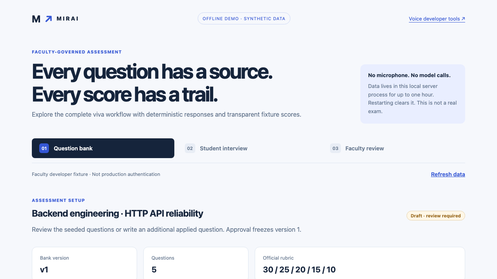
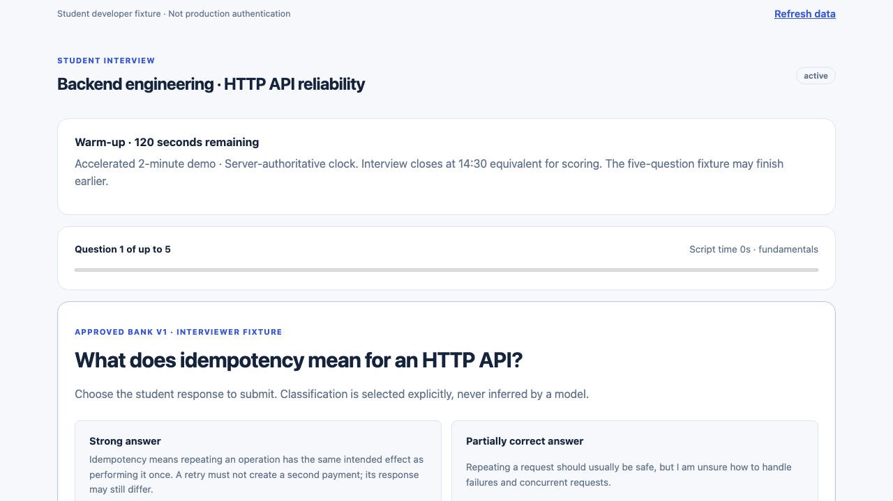
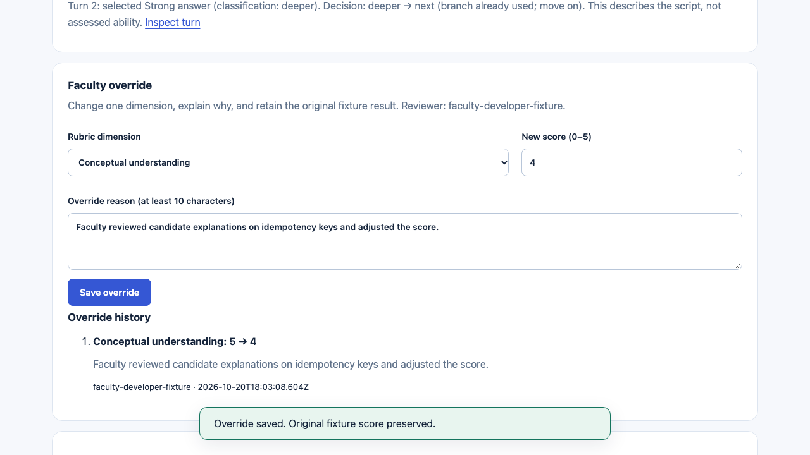
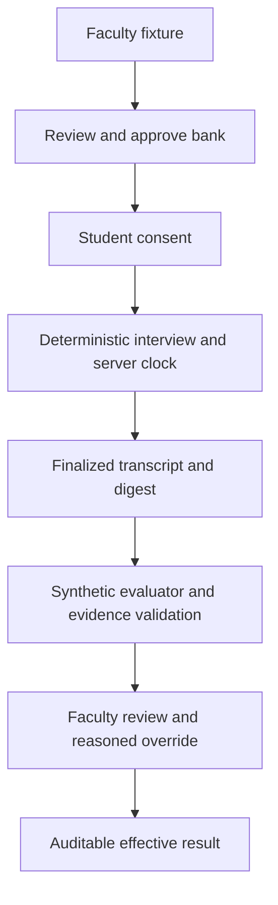
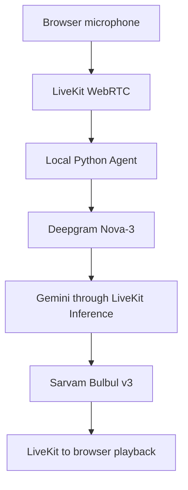

# Mirai AI Interviewer

**Adaptive technical vivas. Evidence-linked evaluation. Faculty-controlled assessment.**

Mirai is a technical viva prototype built around faculty oversight: approve the questions, follow each answer into the scoring evidence, and review or override a mark without losing its history. It addresses the challenge of making large-cohort assessments consistent and auditable.

**Current release: a locally runnable prototype.** The complete offline workflow is tested using prewritten responses and a synthetic evaluator. A separate LiveKit voice integration is implemented behind explicit approval gates, but has **not** been verified with real providers.

[For judges](#for-hackathon-judges) · [Setup](#quick-start) · [Walkthrough](#try-the-workflow) · [Architecture](#architecture) · [Test Report](docs/submission/TEST_REPORT.md)

## For Hackathon Judges

**Try the complete offline review loop.** Requires Node.js ≥20.9, npm and Git; no Python, provider keys or `.env.local` are needed for the demo.

```bash
git clone https://github.com/Udit-Agarwal20/mirai-ai-interviewer.git
cd mirai-ai-interviewer/poc/voice
npm ci
MIRAI_OFFLINE_DEMO=1 npm run dev
```

Open **http://127.0.0.1:3000/demo**. For PowerShell syntax and local-data behavior, see [setup notes](#quick-start).

**Evaluate in 2–3 minutes:** create a workspace → approve the bank → continue to student → consent and start → choose prewritten answers → end the interview → open faculty review → follow a **Turn** evidence link → override a score with a reason. The original mark and audit history remain available.

**Evidence:** [mandatory Test Report](docs/submission/TEST_REPORT.md) · [frontend results](docs/submission/results/frontend.txt) · [Python results](docs/submission/results/python.txt) · [five-minute demo script](docs/submission/DEMO_SCRIPT.md).

**Scope:** the offline flow, clock, evidence validation and overrides are tested. Responses and evaluation are synthetic; no microphone or recording is used. Real provider-backed voice, real-model scoring validation and production-scale operation remain unverified.

## See the workflow



| Student interview | Faculty evidence and override |
|---|---|
|  |  |

Screenshots show the actual local application with synthetic data. No public deployment or demo video is currently available.

## Why Mirai

The MSOT hackathon asks teams to support approximately 350 students taking 15-minute technical vivas, with a target of 100–150 simultaneous sessions. That creates a practical challenge: consistent questioning and marks, less repetitive faculty effort, and enough evidence to review a disputed assessment.

Mirai's prototype makes that review loop tangible. The concurrency target is a requirement to validate—not a measured capability of this release.

<!-- MIRAI_PILOT_FEASIBILITY_START -->
## MSOT pilot feasibility and cost (planning estimates)

**350 students × 15 minutes = 5,250 interview minutes (87.5 hours).** At 150 simultaneous sessions, that is **three 15-minute slots (45 minutes)** plus login, changeover and recovery time; at 100 simultaneous sessions, it is **four slots (60 minutes)** before overhead. These are **capacity calculations, not demonstrated load-test results**.

A transparent **illustrative hosted-agent/API model** estimates **~₹53 per 15-minute viva** in its planning case, using published reference rates and explicit usage/FX assumptions. This is **not a measured Mirai bill, provider quote or all-inclusive deployment budget**. Taxes, fixed plans, operations and extra infrastructure are excluded.

| Cohort size | Planning-case variable cost | 15-minute slots at 150 concurrent |
|---:|---:|---:|
| 200 students | ~₹10,600 | 2 |
| 250 students | ~₹13,250 | 2 |
| 300 students | ~₹15,900 | 2 |
| **350 students** | **~₹18,550** | **3** |

**Deployment blockers:** the existing live PoC is not validated at scale; real recording, production authentication/storage and human-calibrated scoring remain incomplete. LiveKit Inference's published Build/Ship/Scale concurrency allowances are **5/20/50**; 150 needs an approved higher allowance or a different validated arrangement. **No 50/100/150 WebRTC load tests have been run.**

**Judge evidence:** [two-page pilot brief (PDF)](docs/submission/PILOT_FEASIBILITY_BRIEF.pdf) · [pilot decision brief](docs/submission/PILOT_FEASIBILITY_BRIEF.md) · [itemized cost model, assumptions and sources](docs/submission/COST_SHEET.md) · [capacity/quotas, slot schedule and test protocol](docs/submission/CAPACITY_PLAN.md) · [executed tests and missing evidence](docs/submission/TEST_REPORT.md). All numerical estimates are clearly separated from measured results.
<!-- MIRAI_PILOT_FEASIBILITY_END -->

## What works today

| Capability | Current implementation |
|---|---|
| Faculty-controlled setup | Edit synthetic questions, topics and difficulty; approve and freeze a bank version |
| Adaptive workflow | Explicit strong, partial, no-answer and off-topic scenarios select deterministic approved follow-ups |
| Session lifecycle | Server-authoritative offline deadline, visible phase clock and accelerated demonstration mode |
| Evidence-grounded reporting | Canonical transcript, SHA-256 digest, validated evidence references and synthetic five-dimension scores |
| Faculty oversight | Evidence navigation, original/effective marks, mandatory override reason and append-only audit events |

The capabilities above are **verified offline**. The remaining product boundaries are:

| Status | Scope |
|---|---|
| Experimental | LiveKit → Deepgram → Gemini → Sarvam integration; disabled and unverified end to end |
| Not implemented for production | Student authentication, durable persistence, full audio recording and faculty playback |
| Not benchmarked | Real-model scoring, speech accuracy/latency and 50/100/150 concurrent sessions |

Developer fixture identities are not production login. Synthetic scores demonstrate the evaluation contract; they do not measure a student's ability.

## Quick start

Use the [clone, install and launch commands above](#for-hackathon-judges). A fresh installation requires registry access; the offline demo needs no Python or provider keys.

Already installed? From `poc/voice`, run `MIRAI_OFFLINE_DEMO=1 npm run dev`.

Open **http://127.0.0.1:3000/demo**. Use this exact loopback hostname and port: the development API rejects other origins. Stop with Ctrl-C.

Windows PowerShell, after installation:

```powershell
$env:MIRAI_OFFLINE_DEMO="1"
npm run dev
```

Data lives in the local server's memory for up to one hour. A restart clears it. No microphone is used, no provider requests are made, and no audio is recorded by the offline demo.

## Try the workflow

1. Select **Create local demo workspace**.
2. Review or edit the questions, then select **Approve bank v1**.
3. Select **Continue to student →** and keep **Accelerated demo · 2 minutes** selected.
4. Read the simulation notice, check consent and select **Start Interview**.
5. Choose prewritten answers to explore the deterministic follow-up branches.
6. Finish the short path or select **End Interview**.
7. Select **Open faculty fixture review →** and follow a score's **Turn** evidence link.
8. Enter an override score and a reason of at least ten characters; select **Save override**.
9. Inspect the original mark, effective mark and override history.

The clock follows the official warm-up, fundamentals, depth, applied, wrap-up and scoring windows. Standard offline mode closes input at 14:30 within a 15-minute budget; accelerated mode closes at 116 seconds within two minutes. The five-question fixture may end earlier. Its branch graph is not a complete phase-specific examination, and scripted transcript offsets are not speech-latency measurements.

## Architecture

### Verified offline workflow



### Experimental voice pipeline — not live-verified



The voice path requires separate human approval and verified account/billing controls. Its developer safeguards remain one session, at most 120 seconds and five student turns, with bounded output and no automatic provider retries. Do not enable it merely to explore the demo.

## Technology

| Layer | Technology | Purpose / status |
|---|---|---|
| Web application | Next.js 16.4.2, React 19.3.1, TypeScript 5.9.3 | Implemented UI and local server APIs |
| Demo data | Isolated in-memory TypeScript adapter | Ephemeral, not a production database |
| Evaluation | TypeScript contracts, validator and synthetic adapter | Evidence/rubric workflow tested offline |
| Voice transport | livekit-client 2.23.0; LiveKit Agents 1.8.8 | Approval-gated integration |
| Agent runtime | Python 3.12 | Local supervisor and voice orchestration |
| Speech recognition | Deepgram `nova-3` | Experimental streaming adapter |
| Interviewer | `google/gemini-3-flash-preview` via LiveKit Inference | Experimental; no direct OpenAI billing |
| Speech synthesis | Sarvam `bulbul:v3`, speaker `shubh` | Experimental adapter |
| Verification | Playwright 1.64.1, Python unittest | Local UI, domain and mocked integration tests |

## Scoring and evidence

| Dimension | Weight |
|---|---:|
| Conceptual understanding | 30% |
| Depth and reasoning | 25% |
| Problem solving | 20% |
| Practical / project knowledge | 15% |
| Communication | 10% |

Each dimension is scored 0–5. The server computes **Σ(score ÷ 5 × weight)** for a total out of 100. Evidence must reference the finalized transcript; invalid references and unsupported quotations are rejected. Original scores remain intact when faculty apply an attributable override.

The current evaluator uses explicitly labeled synthetic fixtures. Real-model accuracy, repeatability and fairness have not been benchmarked. Short or failed evaluations require review rather than silently receiving invented marks. Student score release remains gated.

## Configuration

Offline mode needs only `MIRAI_OFFLINE_DEMO=1` in the startup command. No `.env.local` is needed.

The [safe environment template](poc/voice/.env.example) documents the separate voice experiment. `LIVEKIT_*`, `DEEPGRAM_API_KEY`, `SARVAM_API_KEY`, `POC_CONTROL_SECRET` and `POC_DEVELOPER_KEY` are server-only configuration. Leave all live approval fields empty. Never commit real values or paste them into issues.

See the [application runbook](poc/voice/README.md) for dependency setup and the experimental boundary.

## Testing

From `poc/voice`, after installing the frontend and test prerequisites below:

```bash
npm run typecheck
npm run build
npm test
```

The full Playwright suite also needs Python 3.12, uv and Chromium:

```bash
cd agent
uv sync --frozen
.venv/bin/python -m unittest -v
cd ..
npx playwright install chromium
npm test
```

On Windows use `.venv\Scripts\python.exe` for Python tests; the current full Playwright supervisor command uses POSIX paths and is supported on macOS/Linux (or WSL). The browser demo itself does not need Python.

The published verification logs record **64 frontend/domain/integration/browser tests and 28 Python tests passed**, plus [TypeScript](docs/submission/results/typecheck.txt) and [production build](docs/submission/results/build.txt). These counts include mocks and synthetic fixtures—not real voice sessions. The suite starts an unarmed loopback supervisor; it must not activate live providers. Keep ports 3000 and 8001 free when testing.

Read the [mandatory Test Report](docs/submission/TEST_REPORT.md) and raw [frontend](docs/submission/results/frontend.txt) / [Python](docs/submission/results/python.txt) results for scope and missing evidence.

## Project map

```text
poc/voice/
├── app/                 # Next.js pages and local APIs
├── lib/demo/            # Ephemeral workspace, policy, clock and role projections
├── lib/evaluation/      # Transcript/evidence contracts and evaluator
├── agent/               # Approval-gated Python voice integration and tests
├── tests/               # Playwright domain, HTTP and browser tests
└── .env.example         # Safe configuration template

docs/
├── assets/screenshots/  # Actual synthetic-demo screenshots
└── submission/          # Architecture, evidence, limitations and runbook
```

## Security and privacy

- Consent precedes the offline interview; the separate voice route also requires explicit microphone preflight.
- Loopback/origin validation and role-scoped cookies restrict demo operations. Workspace creators receive both developer fixtures; this is not institutional authorization.
- No real student identity, audio or personal data is needed for the demonstration.
- Demo transcripts, evaluations and audit history are ephemeral. Durable storage and retention/deletion policy are pending.
- Provider credentials remain server-side. Provider retention is not assumed to be zero.
- This public repository has a fresh, sanitized history. Supplied challenge and planning documents are intentionally excluded.

## Roadmap and limitations

1. Verify one separately authorized, bounded real voice conversation.
2. Implement consent-based two-party recording and faculty playback.
3. Add approved durable storage and production authentication.
4. Validate real-model scoring against human marks and measure speech accuracy/latency.
5. Benchmark 50/100/150 concurrent sessions and document measured costs.

No real recorded viva, production deployment, WER/latency benchmark or concurrency result is claimed. This prototype does not yet satisfy all hackathon evidence requirements.

## Documentation

| Document | Purpose |
|---|---|
| [Architecture](docs/submission/ARCHITECTURE.md) | Implemented boundaries and planned infrastructure |
| [Test Report](docs/submission/TEST_REPORT.md) | Executed checks and explicit evidence gaps |
| [Demo script](docs/submission/DEMO_SCRIPT.md) | Five-minute synthetic workflow walkthrough |
| [Sample bank and rubric](docs/submission/SAMPLE_BANK_AND_RUBRIC.md) | Runnable fixture references and scoring weights |
| [Capacity plan](docs/submission/CAPACITY_PLAN.md) | Cohort slot math, quota blockers, proposed scale test and no capacity claim |
| [Cost sheet](docs/submission/COST_SHEET.md) | Itemized illustrative cost model for 200–350 students; not measured |
| [Pilot feasibility brief](docs/submission/PILOT_FEASIBILITY_BRIEF.md) | Executive decision and evidence gaps |
| [Privacy note](docs/submission/PRIVACY_NOTE.md) | Local data behavior and unresolved policy |

## Contributing and acknowledgments

Open an issue with reproduction steps, expected behavior and relevant offline test results. Keep changes focused and label synthetic data clearly. Never include credentials, personal student information or recordings without permission. Provider activation and new product policies require maintainer review.

Built with Next.js, React, TypeScript, Python, LiveKit and Playwright, with experimental Deepgram, Google Gemini and Sarvam integrations. Inspired by the MSOT viva challenge; no institutional or provider endorsement is implied.

**License:** no open-source license has been granted for this repository. Public visibility does not grant unrestricted redistribution or reuse; contact the maintainer before reuse.
