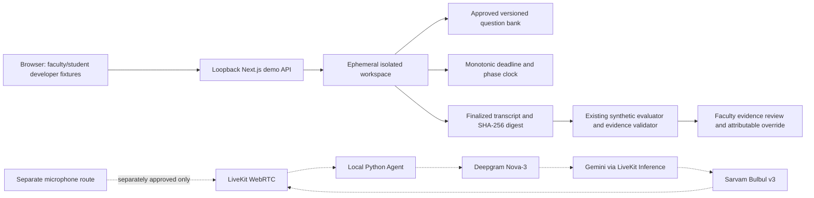

# Mirai architecture — concise submission design

Status: implemented offline demo; separate gated, unverified voice PoC. This short source is intended for a ≤3-page export; no PDF is supplied.

## Implemented boundaries

Next.js/TypeScript serves `/demo`; opaque HttpOnly path-scoped cookies identify developer fixture roles. Loopback/origin checks and an explicit offline flag gate demo routes. Server commands enforce approval, consent, revisions, idempotency, score ranges and reasons. Workspace data is isolated in memory and expires after one hour.

A monotonic clock enforces the offline deadline on commands and via a shared 250ms scheduler. Standard duration is 900 seconds, accelerated demonstration 120 seconds. Speaking ends at 870/116 seconds; the remaining time is reserved for scoring. The short fixture can end earlier. Official phase labels are displayed, but the fixture graph does not constitute a full phase-specific exam.

Finalization seals ordered turns and a digest. The existing provider-independent evaluation service uses its synthetic adapter. Strict evidence validation checks transcript references/quotes. Weighted totals are server-controlled; original and effective scores and override history remain distinct. No real semantic scoring is claimed.

## Pending architecture

Production authentication, approved durable database/migrations, recording/object storage, scoring workers, institutional retention and real provider verification are pending. The in-memory adapter is not horizontally scalable or durable. Voice has separate 120s/five-turn safeguards; this sprint does not change them. No public deployment is authorized.
