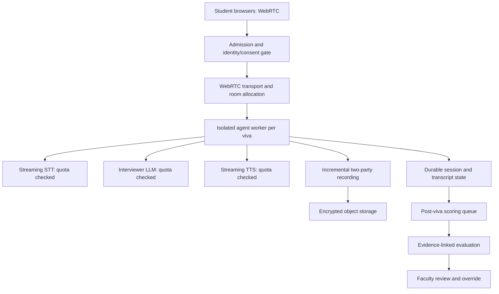

# MSOT 350-student capacity and rollout plan — proposed, NOT load-tested

**Prepared 20 October 2026.** The challenge asks for **100–150 concurrent 15-minute vivas**, and real WebRTC/audio load tests at **50, 100 and 150**. The current Mirai release is an **offline, single-process synthetic demonstration**, not a verified multi-user voice service. Its separate live PoC is restricted to one approved session, up to 120 seconds and five student turns. Nothing here claims demonstrated 150-session throughput.

## Cohort scheduling arithmetic

Assume each student occupies one 15-minute slot, with no overruns. `slots = ceil(students / simultaneous_capacity)`.

| Students | 50 simultaneous | 100 simultaneous | 150 simultaneous |
|---:|---:|---:|---:|
| 200 | 4 slots / 60 min | 2 slots / 30 min | 2 slots / 30 min |
| 250 | 5 slots / 75 min | 3 slots / 45 min | 2 slots / 30 min |
| 300 | 6 slots / 90 min | 3 slots / 45 min | 2 slots / 30 min |
| **350** | **7 slots / 105 min** | **4 slots / 60 min** | **3 slots / 45 min** |

The 350-student **under-one-hour** objective is only arithmetically plausible at **150 simultaneous sessions** (45 minutes plus less than 15 minutes total changeover). At 100 simultaneous sessions, the nominal 60 minutes already excludes login, setup, delays and recovery. These are calculations, **not measured throughput**.

## Proposed production topology (NOT implemented)

**This diagram is a target design, not a depiction of existing production infrastructure.** The current offline store is in-memory and cannot be distributed across workers without durable storage and concurrency controls.

## Required capacity at 150 simultaneous sessions

| Dependency | Minimum planning implication | Current evidence / blocker |
|---|---|---|
| Browser/WebRTC | 150 authenticated, isolated rooms and working audio paths | No 150-client audio test |
| Agent workers | 150 concurrent session allocations, CPU/RAM sizing and worker restarts | Current live PoC allows one session; no measured worker density |
| Streaming STT | Up to 150 active streams plus operational headroom | Deepgram lists up to **150 WebSocket streams** on Pay As You Go; verify *actual account* quota and headroom |
| LLM inference | Sufficient concurrent model requests and throughput for 150 sessions | LiveKit Inference lists **5/20/50** concurrent sessions on Build/Ship/Scale; **150 needs custom approval or different approved architecture** |
| Streaming TTS | 150 possible bursts, chars/sec quotas and language/speaker availability | Sarvam account-specific concurrency/rate limits unverified |
| Storage/recording | 350 durable session records; consented two-party audio, transcripts, audit and recovery | Not implemented for production |
| Scoring | Asynchronous queue with 350 jobs after sessions, retries and idempotency | Offline synthetic evaluator only; real scorer not validated |
| Operations | Metrics, logs, alerts, controlled rollout, rate-limit policies, faculty incident procedure | No deployed SLOs or production operations |

Provider references: [LiveKit Inference pricing and concurrency](https://livekit.com/pricing/inference), [Deepgram pricing and concurrency](https://deepgram.com/pricing), [Sarvam pricing and limits](https://docs.sarvam.ai/api/getting-started/pricing). Pricing tiers and published quotas may change; verify live account settings and contract before the pilot. Published maxima do not guarantee the actual account's entitlement.

## Storage sizing illustration (not a measured recording)

`audio_bytes = students × 15 × 60 × bitrate_bits_per_second ÷ 8`.

At a **hypothetical** 32 kbps encoded mono track, 350 × 15 minutes is about **1.26 GB** of encoded audio (decimal GB), excluding metadata, replicas and container overhead. Two independently recorded 32 kbps tracks would be about **2.52 GB** before overhead. Actual codec, channel count, encryption, retention and egress must be confirmed; these are not current Mirai recordings.

## Admission control, failures and quotas — proposed policies

1. **Before scheduling:** verify paid-service authorization, budget caps, quotas, account-specific provider rates, recording consent and faculty escalation ownership. Do not admit students to a slot beyond verified capacity.
2. **At admission:** atomically reserve a session slot, room and worker; issue scoped identity; record consent; reserve storage. Maintain per-provider token buckets or quota budgets.
3. **During interview:** stream student audio, checkpoint transcript and recording chunks durably, enforce the 15-minute server deadline, monitor end-of-speech to first-audio latency, and preserve evidence provenance.
4. **On rate limits or provider outage:** apply bounded retries only where safe and idempotent; for live audio do not silently switch providers or restart scoring in a way that changes fairness. Pause admission, show a transparent incident state, and reschedule or move to faculty review under a documented policy. Provider fallback requires prior approval and fairness testing.
5. **After viva:** enqueue scoring separately from real-time traffic; validate rubric evidence; flag low-confidence output; allow attributable faculty override; release results only under policy.
6. **On crash/rejoin:** restore from durable state with explicit session and recording continuity checks. This is a proposed design, not current functionality.

## Required load-test protocol and result template

Use **actual WebRTC clients with recorded or synthetic audio**, not repeated HTTP fixture calls. Run 50 → 100 → 150 sessions with controlled duration and a documented stopping threshold. Obtain provider budget approval before running any paid traffic.

| Concurrent sessions | p50 end-of-speech→audio | p95 end-of-speech→audio | STT/TTS/LLM errors | Drops/rejoins | CPU/RAM/GPU | Result |
|---:|---|---|---|---|---|---|
| 50 | NOT TESTED | NOT TESTED | NOT TESTED | NOT TESTED | NOT TESTED | NOT TESTED |
| 100 | NOT TESTED | NOT TESTED | NOT TESTED | NOT TESTED | NOT TESTED | NOT TESTED |
| 150 | NOT TESTED | NOT TESTED | NOT TESTED | NOT TESTED | NOT TESTED | NOT TESTED |

**Official latency target:** p95 below **2.5 seconds**. Also report the **first breaking point**, which component saturated, rate-limit responses, dropped sessions, and raw results/scripts. Example *proposed* internal acceptance gates (not official): zero silent data loss; ≥99% session completion; no unapproved spend; no unexplained score changes. Real thresholds require MSOT approval.

## Go / no-go gates

| Gate | Required proof | Current status |
|---|---|---|
| G1: Functional real voice | Consented 15-minute real voice viva with durable recording and faculty replay | **NO-GO — incomplete** |
| G2: Evaluation validity | ≥10 faculty-vs-AI pairs; repeat consistency; evidence audit and fairness tests | **NO-GO — incomplete** |
| G3: Speech reliability | ≥20 Indian English/Hinglish clips with WER; p50/p95 latency; noise/rejoin tests | **NO-GO — incomplete** |
| G4: Capacity | 50/100/150 audio-bot runs, breaking point, approved quotas and recovery | **NO-GO — incomplete** |
| G5: Institutional readiness | Security review, production auth, storage, retention, access controls, final provider budget | **NO-GO — incomplete** |

**Feasibility conclusion:** a 350-student pilot is **architecturally plausible in principle**, but **not currently demonstrated or approved**. The offline prototype verifies selected workflow/evaluation contracts, not real speech quality, 150-session concurrency, durability, or actual operating cost. See [Cost Sheet](COST_SHEET.md) and [Test Report](TEST_REPORT.md).
